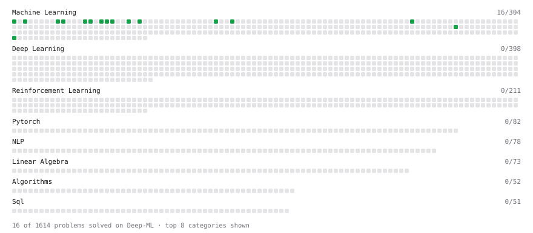

# Deep-ML

My machine learning practice from [Deep-ML](https://www.deep-ml.com). Every solution here was written by hand.

**20** solved · 20 problems · 0 labs · 0 math

[**Browse the interactive portfolio**](https://mdzaid2810.github.io/deep-ml/) to replay this filling in over time.

## Problems

| | Difficulty | Solved | |
| --- | --- | --- | --- |
| [Batch Iterator for Dataset](https://www.deep-ml.com/problems/30) | easy | 2026-10-18 | [solution](problems/0030-batch-iterator-for-dataset) |
| [Calculate Accuracy Score](https://www.deep-ml.com/problems/36) | easy | 2026-10-18 | [solution](problems/0036-calculate-accuracy-score) |
| [Calculate SVM Margin Width](https://www.deep-ml.com/problems/282) | easy | 2026-10-20 | [solution](problems/0282-calculate-svm-margin-width) |
| [Combined RM and LLM Quality Filter](https://www.deep-ml.com/problems/794) | easy | 2026-10-20 | [solution](problems/0794-combined-rm-and-llm-quality-filter) |
| [Feature Scaling Implementation](https://www.deep-ml.com/problems/16) | easy | 2026-10-17 | [solution](problems/0016-feature-scaling-implementation) |
| [Implement Early Stopping Based on Validation Loss](https://www.deep-ml.com/problems/135) | easy | 2026-10-19 | [solution](problems/0135-implement-early-stopping-based-on-validation-loss) |
| [Implement Gini Impurity Calculation for a Set of Classes](https://www.deep-ml.com/problems/64) | easy | 2026-10-20 | [solution](problems/0064-implement-gini-impurity-calculation-for-a-set-of-classes) |
| [Implement Hinge Loss for SVM](https://www.deep-ml.com/problems/283) | easy | 2026-10-20 | [solution](problems/0283-implement-hinge-loss-for-svm) |
| [Implement Precision Metric](https://www.deep-ml.com/problems/46) | easy | 2026-10-18 | [solution](problems/0046-implement-precision-metric) |
| [Implement Recall Metric in Binary Classification](https://www.deep-ml.com/problems/52) | easy | 2026-10-18 | [solution](problems/0052-implement-recall-metric-in-binary-classification) |
| [Implement Ridge Regression Loss Function](https://www.deep-ml.com/problems/43) | easy | 2026-10-18 | [solution](problems/0043-implement-ridge-regression-loss-function) |
| [Linear Kernel Function](https://www.deep-ml.com/problems/45) | easy | 2026-10-18 | [solution](problems/0045-linear-kernel-function) |
| [Linear Regression Using Normal Equation](https://www.deep-ml.com/problems/14) | easy | 2026-10-17 | [solution](problems/0014-linear-regression-using-normal-equation) |
| [Measure Disorder in Apple Colors](https://www.deep-ml.com/problems/108) | easy | 2026-10-19 | [solution](problems/0108-measure-disorder-in-apple-colors) |
| [One-Hot Encoding of Nominal Values](https://www.deep-ml.com/problems/34) | easy | 2026-10-18 | [solution](problems/0034-one-hot-encoding-of-nominal-values) |
| [Random Shuffle of Dataset](https://www.deep-ml.com/problems/29) | easy | 2026-10-17 | [solution](problems/0029-random-shuffle-of-dataset) |
| [Windowed Time-Series Dataset with Multi-Step Targets](https://www.deep-ml.com/problems/1385) | easy | 2026-10-20 | [solution](problems/1385-windowed-time-series-dataset-with-multi-step-targets) |
| [Implement K-Fold Cross-Validation](https://www.deep-ml.com/problems/18) | medium | 2026-10-21 | [solution](problems/0018-implement-k-fold-cross-validation) |
| [K-Means Clustering](https://www.deep-ml.com/problems/17) | medium | 2026-10-21 | [solution](problems/0017-k-means-clustering) |
| [Principal Component Analysis (PCA) Implementation](https://www.deep-ml.com/problems/19) | medium | 2026-10-21 | [solution](problems/0019-principal-component-analysis-pca-implementation) |

---

_This file is regenerated by Deep-ML on every push._
